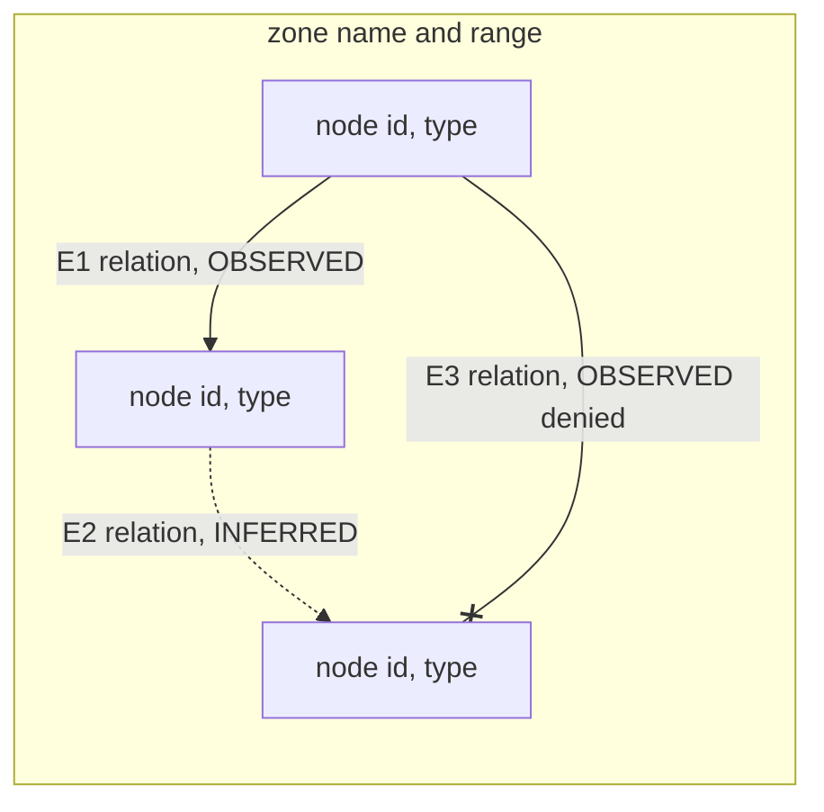
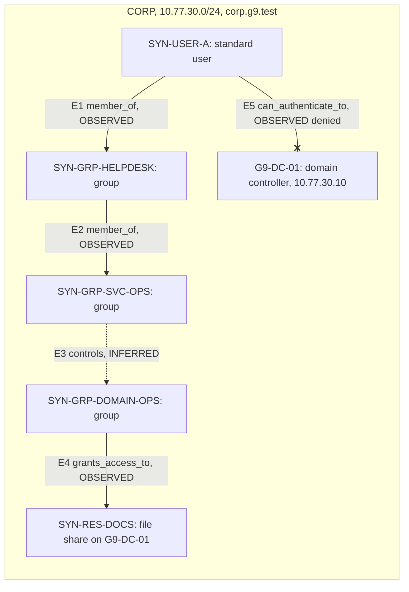

# Attack path graph template

- Source: plan section 0.1 (template named, no field list). Context: plan section 5 (week 6 expansion: "separate attack-path diagram and decision tree for reducing false positives"; week 10 outputs: graph, directory access matrix, hypothesis/evidence table, before-after permission test; week 12: one identity or privilege path), section 6 (week 10 lab), section 9.3 (day 50: reachability in a graph is not achieved access) and section 4 (BloodHound CE: "avoid blind attack-path conclusions").
- Status: PROPOSED. This is a blank template. It holds no graph and no path, and no record made with it exists in the repository. The Mermaid example was written by hand; no Mermaid renderer or validator was run on it (NOT RUN).
- Reader: the learner, who draws and argues the path, and the examiner, who ticks the quality checks.
- Claim labels: OBSERVED, INFERRED, ASSUMED, UNVERIFIED, NOT RUN.

## How to use

When. In week 6 (a privilege or routing path across segments), in week 10 (directory permission paths), and for the identity or privilege path of the final. Draw a graph when a conclusion needs more than one hop: it forces every hop to state its precondition and its evidence.

Where the data comes from. Only from collections that you were authorised to run, under a signed RoE for the exercise, or from a supplied synthetic dataset (`docs/curriculum/v2/SAFETY_AUTHORIZATION.md` section 2.2, classes E and H, and section 8). A graph tool shows relationships present in the data at the moment of collection. It is a model.

Order of work.

1. Write the question: from which starting position to which target resource, and what the path would mean if it were real.
2. Record the collection: tool and version, time with zone, the account it ran as, and its scope (domains, hosts, object types).
3. List the nodes and then the edges, each with its precondition.
4. Mark every edge with its claim label (below). Do not mark an edge OBSERVED because the tool drew it.
5. Test what you are authorised to test, edge by edge and then end to end, with a prediction written before each test and an outcome after it.
6. Write what the graph proves and does not prove (below), and the telemetry the demonstrated edges should leave.
7. After a fix, re-collect, redraw, and test the effective access with a positive and a negative case. A graph that no longer shows the edge does not prove that the access is gone.

Done when the quality checks below are ticked, every edge has its label and evidence reference, every path has a classification, and a stranger could redraw the graph from the registers.

Handling. Names are synthetic. Use the plan's lab addresses (`10.77.10.0/24` RED, `10.77.20.0/24` DMZ, `10.77.30.0/24` CORP) and the domain `corp.g9.test`, and no real domain, host or person. Any test that changes state is under an approval record (`docs/curriculum/v2/TEMPLATES/CHANGE_APPROVAL.md`).

## What the graph proves and does not prove

| A graph can show | It does not show |
|---|---|
| a relationship that was present in the collected data at the collection time | that the data was complete (collection scope, collector permissions), current (changes since collection) or correct |
| a path between two nodes in the model | that anyone can walk it. Preconditions and controls that the data does not model (filters, tiering, authentication requirements, host hardening) can stop it. Reachability in a graph is not achieved access |
| an edge whose test you ran and recorded (OBSERVED) | that the edge works from another position, another time or another state |
| the shortest path in the model | the most likely or the most damaging path; attackers differ in knowledge and position |
| no path between two nodes | that none exists: an edge that was not collected is absent from the graph |
| that an edge disappeared after re-collection | that effective access is gone. Only a test shows that |
| that a collection or a graph query was run | that anything was compromised. A collection tool's activity is not evidence of an attack |
| the names and types of objects | their business weight. Criticality is ASSUMED unless an inventory states it |

## Vocabulary

Edge claim label (what you know about the edge):

| Label | Meaning | Drawn as |
|---|---|---|
| OBSERVED | the edge was exercised or read directly in scope, the outcome was saved, and the state at the time is recorded | solid arrow when it allowed the step; arrow with a cross when it denied it |
| INFERRED | derived from collected data or documentation by reasoning, not exercised | dashed arrow |
| ASSUMED | taken without data, for example a user's behaviour or a network position | dashed arrow, label says ASSUMED |
| NOT RUN | a test is proposed, not run | dashed arrow, label says NOT RUN |

Edge outcome: ALLOWED, DENIED, NOT TESTED. A tested edge that was denied stays in the graph with its evidence: a denial is a result.

Path classification (PROPOSED):

| Class | Meaning |
|---|---|
| DEMONSTRATED | every edge was exercised in one scoped test from the stated start to the stated end, and the start and end states and the artifacts are recorded |
| MODELLED | at least one edge is INFERRED, ASSUMED or NOT RUN. The path is a hypothesis, and its strength is that of its weakest edge |
| REFUTED | a test shows an edge denied under the stated preconditions. The path is closed in that state, with the evidence |

Node types: principal (user, service account), group, host, service, resource (a file share, a record store), zone, privilege or right, and credential material (synthetic only). Edge relations (own names, not a technique list): member_of, controls (a right that lets one object change another), can_reach (network path allowed by policy), can_authenticate_to, holds_session_on, grants_access_to.

## Edge validation steps

Use these steps to reduce false positives before an edge is drawn as more than INFERRED. The steps are decisions; a test inside them needs its own approval and its own record.

| Step | Question | If the answer is no |
|---|---|---|
| 1 | is the relationship in data you collected in scope, with a recorded time, tool and version? | label ASSUMED |
| 2 | has the environment changed since the collection? | re-collect, or label the edge with the age of its data |
| 3 | can its precondition be met in this environment (position, privilege, user action, reachability by policy)? | remove the edge, and record why |
| 4 | does a control apply that the data does not model (a deny rule, filtering, tiering, multi-factor requirement, host hardening)? Read it. | note the control on the edge; test with it present |
| 5 | is a test of the edge in scope and approved? | the edge stays INFERRED or NOT RUN |
| 6 | after the test, was the prediction met? | record DENIED or ALLOWED honestly; revise the hypothesis; do not redraw to fit |
| 7 | what telemetry should the exercise of this edge leave, and was it seen at the source and at the collector? | write the gap; see `docs/curriculum/v2/TEMPLATES/DETECTION_RULE_TEST.md` |

## Registers

Keep three registers beside the diagram. The diagram is a view of them.

| Register | Columns |
|---|---|
| Nodes | node id, type, synthetic name, zone, source of the fact and its time, criticality (ASSUMED unless an inventory states it) |
| Edges | edge id, from, to, relation, precondition (OBSERVED or ASSUMED), claim label, outcome, evidence reference (artifact id and hash, or NOT RUN), the control that would break it, expected telemetry, state after the fix |
| Paths | path id, ordered edge ids, weakest edge and its label, classification, what the path would permit if demonstrated, the test still needed, the test that would refute it |

Also keep the collection record (tool, version, time with zone, account, scope) and the hypothesis and evidence table that week 10 asks for: each hypothesis, the evidence for it, the evidence against it, and the discriminating test.

## Blank diagram

Copy the block. Replace the names. Keep the legend.

Legend: solid arrow, edge observed and allowed; dashed arrow, edge inferred, assumed or not run; arrow with a cross, edge observed and denied.

## Quality checks before you submit

An examiner ticks each line from the diagram, the registers and the evidence only.

Data and scope

- [ ] The collection is recorded: tool and version, time with zone, account, scope, and the authorisation (RoE id) under which it ran, or the supplied dataset's id and hash.
- [ ] Every node has a type, a zone, and the source and time of the fact; criticality is labelled ASSUMED unless an inventory states it.
- [ ] Names, addresses and domain are synthetic or the plan's lab addresses; nothing real appears.

Edges

- [ ] Every edge has a relation, a precondition marked OBSERVED or ASSUMED, a claim label, an outcome, an evidence reference or NOT RUN, and the control that would break it.
- [ ] No edge is labelled OBSERVED because a tool drew it; an OBSERVED edge has a saved test result with the state at the time.
- [ ] Edges differ visually by claim label and outcome, and the legend is present.
- [ ] A denied edge stays in the graph with its evidence.

Paths and claims

- [ ] Every path has a classification, and the weakest edge and its label are named.
- [ ] No path is called exploitable, open or achieved without an end-to-end test in scope with recorded start and end states; otherwise it is MODELLED.
- [ ] The absence of a path is not presented as security, and the collection's limits are stated beside it.
- [ ] No conclusion treats the collection tool's own activity as evidence of an attack.
- [ ] The hypothesis and evidence table lists evidence against each hypothesis as well as for it.

Telemetry and fix

- [ ] For each demonstrated edge the expected telemetry is named and was seen at the source and at the collector, or the gap is stated.
- [ ] After a fix, the graph was re-collected and redrawn, and the effective access was tested with a positive case (the intended function works) and a negative case (the earlier access is denied), each with an artifact.
- [ ] The diagram can be redrawn from the registers by a stranger.

## Sample (synthetic)

Nothing below was observed. The graph, the names and the outcomes are invented to show the notation and the registers. The relationships are generic and are not a technique.

Sample (synthetic) registers, abridged:

| Edge | Precondition | Claim | Outcome | Evidence | Control that would break it | After the fix |
|---|---|---|---|---|---|---|
| E1 | none beyond the account's existence | OBSERVED | ALLOWED | group listing, artifact SYN-A1 | remove the membership | not applicable |
| E3 | the right is present on the group object and effective for this principal | INFERRED | NOT TESTED | derived from a collected permission list, not exercised | remove the right | re-collect and test |
| E5 | interactive sign-in right on the host | OBSERVED | DENIED | test record SYN-T5, prediction written first | none needed: already denied | unchanged |

| Path | Edges | Weakest edge | Classification | Test still needed |
|---|---|---|---|---|
| SYN-P1: SYN-USER-A to SYN-RES-DOCS | E1, E2, E3, E4 | E3, INFERRED | MODELLED | exercise E3 in scope under an approval record; predict the outcome first |

Reading of the sample: the graph does not show that SYN-USER-A reaches SYN-RES-DOCS. It shows a path in the model whose third hop was not tested. If E3 were tested and denied, SYN-P1 would become REFUTED, and the denial would stay in the graph.

## Departures from the plan

| What | Why |
|---|---|
| The whole structure (labels, outcomes, path classes, registers, validation steps) is this template's own | the plan names the template and gives it no field list; its requirements are the nodes, edges, preconditions and the limits of what a graph proves. PROPOSED |
| The week 6 "decision tree for reducing false positives" is given as a table of steps, not a drawn tree | a table of questions with the action for a "no" answer carries the same decisions in plain Markdown. The week 6 materials may draw a tree. PROPOSED |
| The Mermaid example was not rendered | no renderer was run (NOT RUN); check that it renders where you use it |
